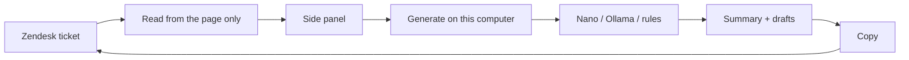

# Zendesk Whisperer

**On-device copilot for Arbitrip agents in Zendesk.**  
Reads the open ticket from the page and returns a summary plus copy-ready drafts without sending the thread to the cloud.

Internal only · Not a Zendesk App · Not Chrome Web Store

---

## The problem

An agent opens a long ticket: guest, hotel, supplier, internal notes. They need to know what the guest wants, what already happened, and what is blocking — then write Hebrew to the customer and English to the hotel.

That costs time. Tone is inconsistent.

## What Whisperer does

The agent stays in Zendesk, clicks the extension icon, and gets a side panel.

| The agent gets | Why it matters |
| --- | --- |
| **Summary** in our internal-note format | Order id, supplier, description, actions taken, follow-up ready to paste |
| **Draft to the guest** | Hebrew, specific to this ticket |
| **Draft to hotel / supplier** | Professional English |
| **Hebrew by choice** | Mark only Guest / Hotel / Supplier / Summary |
| **Copy only** | The agent decides what to send. Zendesk is never written automatically |

## The ticket never leaves the computer

No OpenAI. No cloud Gemini. No provider API key in the extension.

Generate runs **on the agent’s machine**, in this order:

1. Chrome’s on-device model (Gemini Nano), if the hardware supports it  
2. Otherwise [Ollama](https://ollama.com) on `127.0.0.1` only  
3. Otherwise built-in rules. no network at all  

A remote Ollama URL is **rejected**. Ticket text is not posted to our servers or to a public AI host.

## How it works



- **Not** a Zendesk App or iframe  
- **Not** the Zendesk REST API  
- **Not** auto-send or auto-insert into the composer  
- Switching tickets clears the previous summary — no mix-up between cases

## Install (two minutes)

1. Chrome → `chrome://extensions`  
2. Developer mode  
3. **Load unpacked** → this folder  
4. Open a real ticket on [arbitrip-support.zendesk.com](https://arbitrip-support.zendesk.com)  
5. Extension icon → **Generate** → **Copy** → paste into Zendesk yourself  

Or from this folder:

```bash
npm start
```

That opens Chrome with the extension loaded. There is no localhost website this is a Chrome extension.

### Ollama (optional, if Nano is unavailable)

```bash
ollama pull llama3.1
ollama serve
```

In Options: `http://127.0.0.1:11434`, model `llama3.1`.

## What we deliberately leave out

- Sending on the agent’s behalf  
- Writing into the Zendesk composer  
- Calling the Zendesk API  
- Storing tickets in the cloud  
- Public Chrome Web Store listing  

This is an aid for the agent’s judgment, not automation that can send the wrong thing to a guest.

## Repo map

```
cmps/ticket-reader/   one small file per step of reading the Zendesk page
cmps/background/      open the side panel and pass the ticket through
cmps/copilot/         Generate on this computer (Nano / Ollama / rules) + Hebrew
cmps/sidepanel/       the panel the agent sees
cmps/options/         local-model settings
style/                CSS only
```

## Commits

Notes sit next to each commit so the history reads as a product story, not a dump of file names.

| Commit | Title | Note |
| --- | --- | --- |
| [`105bd06`](https://github.com/Omri-Gendler/zendesk-whisperer/commit/105bd0627d96d8095cc6e30d2b0a3e0a0476c529) | Restore the local copilot | First working extension: side panel on Zendesk, ticket from the DOM only, Generate on this computer (Nano / Ollama / rules). No public AI. |
| [`d2974f1`](https://github.com/Omri-Gendler/zendesk-whisperer/commit/d2974f1ff1b1194751efe4916f118111dc72c712) | Summary template + Hebrew controls | Internal-note summary (order id, supplier, description, actions, follow-up). Mark **Guest / Hotel / Supplier / Summary** for Hebrew. Copy-only drafts. |
| [`47e06af`](https://github.com/Omri-Gendler/zendesk-whisperer/commit/47e06af3a068393bade29c348a1549f009fcbcf6) | README and product page | First product landing page in Hebrew. Replaced by the English page below. |
| [`a1518ba`](https://github.com/Omri-Gendler/zendesk-whisperer/commit/a1518ba5b32ea932b09592f57c5221c4d0d5512c) | English GitHub + commit notes | README and product page in English. Each commit has a note beside it so the history is readable. |
| [`df64f56`](https://github.com/Omri-Gendler/zendesk-whisperer/commit/df64f56c9a2cf089145d28831c079cba2a2da820) | Commit notes on the landing page | Listed the English landing-page commit beside the others. |
| [`8f4b6b8`](https://github.com/Omri-Gendler/zendesk-whisperer/commit/8f4b6b86dc7c45eed3c65cc5a8bcf860c693adcd) | cmps modules | Ticket reader, generate, Hebrew, side panel, and options each in their own folder. Generate on this computer (Nano / Ollama / rules). |

## Enterprise install

Internal extension. After a pilot: Chrome `ExtensionInstallForcelist`. No public store.

---

*Arbitrip · EL AL Travel support · internal*
