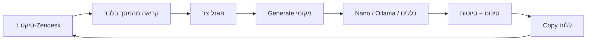

# Zendesk Whisperer

**קופיילוט מקומי לסוכני Arbitrip ב-Zendesk.**  
קורא את הטיקט הפתוח מהמסך, ומחזיר סיכום + טיוטות מוכנות להעתקה — בלי לשלוח את השיחה לענן.

[מצגת להנהלה](docs/pitch.html) · פנימי בלבד · לא Zendesk App · לא Web Store

---

## הבעיה

סוכן פותח טיקט ארוך: לקוח, מלון, ספק, הערות פנימיות. הוא צריך להבין מה הלקוח רוצה, מה כבר נעשה, ומה חוסם — ואז לכתוב תשובה בעברית ללקוח ומייל באנגלית למלון.

זה עולה זמן, והטון לא אחיד.

## מה Whisperer עושה

הסוכן נשאר ב-Zendesk. לוחץ על אייקון התוסף. מקבל פאנל צד.

| הסוכן מקבל | למה זה חשוב |
| --- | --- |
| **סיכום** בפורמט הערה פנימית | מספר הזמנה, ספק, תיאור, פעולות, המשך טיפול — מוכן להדבקה |
| **טיוטה ללקוח** | עברית, אמפתית, ספציפית לטיקט הזה |
| **טיוטה למלון / ספק** | אנגלית מקצועית |
| **עברית לפי בחירה** | מסמנים רק לקוח / מלון / ספק / סיכום |
| **Copy בלבד** | הסוכן מחליט מה לשלוח. Zendesk לא נכתב אוטומטית |

## כלל הזהב: הטיקט לא יוצא מהמחשב

אין קריאה ל-OpenAI. אין Gemini בענן. אין מפתח ספק בתוסף.

Generate רץ **על המחשב של הסוכן**, בסדר הזה:

1. מודל מובנה ב-Chrome (Gemini Nano), אם המחשב תומך  
2. אחרת [Ollama](https://ollama.com) רק על `127.0.0.1`  
3. אחרת כללים מובנים בתוסף — בלי רשת בכלל  

כתובת מרוחקת ל-Ollama **נדחית**. טקסט הטיקט לא נשלח לשרת שלנו וגם לא לספק AI ציבורי.

## איך זה עובד



- **לא** Zendesk App ולא iframe  
- **לא** Zendesk REST API  
- **לא** שליחה או הדבקה אוטומטית לקומפוזר  
- החלפת טיקט מוחקת את הסיכום הקודם — אין ערבוב בין פניות

## התקנה (שתי דקות)

1. Chrome → `chrome://extensions`  
2. Developer mode  
3. **Load unpacked** → התיקייה הזו  
4. טיקט אמיתי ב-[arbitrip-support.zendesk.com](https://arbitrip-support.zendesk.com)  
5. אייקון התוסף → **Generate** → **Copy** → הדבקה ידנית ב-Zendesk  

או מהתיקייה:

```bash
npm start
```

נפתח Chrome עם התוסף טעון. אין אתר ב-localhost — זו הרחבת Chrome.

### Ollama (אופציונלי, אם אין Nano)

```bash
ollama pull llama3
ollama serve
```

ב-Options: `http://127.0.0.1:11434`, מודל `llama3`.

## מה במכוון אין כאן

- שליחה בשם הסוכן  
- כתיבה לקומפוזר של Zendesk  
- חיבור ל-API של Zendesk  
- שמירת טיקטים בענן  
- פרסום ב-Chrome Web Store  

זה כלי עזר לשיקול של הסוכן — לא אוטומציה שיכולה לשלוח משהו שגוי ללקוח.

## מבנה קצר

| קובץ | תפקיד |
| --- | --- |
| `content-script.js` | שולף את הטיקט מהדף. `SELECTORS` למעלה אם Zendesk משנה markup |
| `local-llm.js` | Nano → Ollama מקומי → כללים. דוחה host מרוחק |
| `local-summarizer.js` | סיכום וטיוטות כשאין מודל |
| `sidepanel.*` | ממשק הקופיילוט |
| `docs/pitch.html` | מצגת להנהלה — לפתוח בדפדפן |

## התקנה ארגונית

תוסף פנימי. אחרי פיילוט: Chrome `ExtensionInstallForcelist`, בלי חנות ציבורית.

---

*Arbitrip · EL AL Travel support · פנימי*
